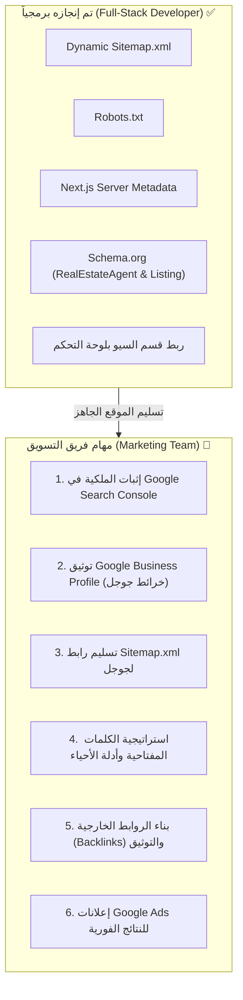

# دليل تهيئة محركات البحث الخارجية وإعدادات Google
## خاص بفريق التسويق الرقمي (Marketing Team) — شركة إشراقة المستقبل للتطوير العقاري

> [!IMPORTANT]
> **إخلاء مسؤولية وتحديد الصلاحيات:**
> هذا الدليل موجّه بالكامل إلى **فريق التسويق وإدارة النمو (Marketing & Growth Team)**. 
> كافة المهام البرمجية والفنية (Technical SEO) مثل (إعداد ملفات Sitemap التفاعلية، ملف Robots.txt، أكواد الميتا، ربط لوحة التحكم بالبيانات المنظمة Schema.org، وسرعة الموقع) **تم إنجازها واختبارها بالكامل داخل الكود من قِبل مطور الويب (Full-Stack Developer)**.
> المهام المذكورة أدناه هي **مسؤولية تسويقية وتشغيلية 100%** وتتطلب حسابات الشركة البنكية أو الرسمية وبيانات السجل التجاري ورخصة فال، ولا تقع ضمن نطاق عمل المطور.

---



---

## 1. إعداد Google Search Console وطلب الفهرسة

يعتبر **Google Search Console** هو قناة التواصل الرسمية بين موقعك وبين محرك بحث Google.

### الخطوات العملية لفريق التسويق:

1. **الدخول إلى المنصة:**
   - توجه إلى الرابط: [search.google.com/search-console](https://search.google.com/search-console)
   - سجّل الدخول باستخدام إيميل Google رسمي للشركة (مثال: `marketing@eshraqat-almustaqbal.com` أو إيميل جيميل رسمي).

2. **إضافة النطاق وتأكيد الملكية (Domain Verification):**
   - اختر خيار **النطاق (Domain)** واكتب الدومين بدون `https://` (مثال: `eshraqat-almustaqbal.com`).
   - ستعطيك جوجل كود تحقق من نوع `TXT Record`.
   - اطلب من مسؤول الدومين (GoDaddy / Cloudflare / Namecheap) إضافة هذا السجل في الـ DNS. بمجرد إضافته، اضغط على **"تأكيد (Verify)"**.

3. **إرسال خريطة الموقع (Sitemap Submission):**
   - من القائمة الجانبية في Search Console، اضغط على **"ملفات Sitemap" (Sitemaps)**.
   - في خانة إضافة ملف جديد، اكتب فقط:
     ```text
     sitemap.xml
     ```
   - اضغط **"إرسال (Submit)"**.
   - ستظهر الحالة باللون الأخضر: **"تم بنجاح (Success)"**. خريطة الموقع التي برمجها المطور تسحب تلقائياً أي عقار جديد يُنشر من لوحة التحكم وترسله إلى Google.

4. **طلب الفهرسة الفورية (Request Indexing):**
   - في شريط البحث العلوي داخل Search Console (فحص أي عنوان URL):
     - أدخل رابط الصفحة الرئيسية: `https://eshraqat-almustaqbal.com`
     - اضغط على **"طلب الفهرسة (Request Indexing)"**.
     - كرر نفس الخطوة لصفحة الكتالوج: `https://eshraqat-almustaqbal.com/properties`
     - كرر الخطوة لأهم 5 عقارات مميزة تم نشرها.
   *(عادةً تستغرق الفهرسة من 24 ساعة إلى أسبوع حتى تظهر في نتائج البحث).*

5. **المتابعة الأسبوعية:**
   - متابعة تقرير **"التغطية / الصفحات" (Pages)** لمعرفة الصفحات المفهرسة.
   - متابعة تقرير **"الأداء" (Performance)** لمعرفة ما هي الكلمات التي كتبها الناس في السعودية وأدت لظهور موقعك (Queries & Impressions).

---

## 2. توثيق نشاطك التجاري على خرائط جوجل (Google Business Profile)

> [!IMPORTANT]
> في السوق العقاري السعودي، أكثر من **60% من عمليات البحث** مثل *"عقارات في الرياض"* أو *"شركة تطوير عقاري"* تظهر أولاً في **مربع الخرائط (Google Map Pack)** أعلى نتائج البحث العادية!

### الخطوات العملية لفريق التسويق:

1. الدخول إلى [google.com/business](https://google.com/business).
2. إضافة اسم النشاط التجاري مطابقاً للترخيص:
   - **الاسم المقترح:** `شركة إشراقة المستقبل للتطوير العقاري | عقارات وفلل الرياض`
3. اختيار الفئة الرئيسية:
   - **الفئة الأساسية:** `شركة تطوير عقاري (Real Estate Developer)`
   - **فئات إضافية:** `وكالة عقارية (Real Estate Agency)`، `مستشار عقاري (Real Estate Consultant)`
4. إدخال العنوان الدقيق لمقر الشركة في مدينة الرياض مع تحديد الدبوس على الخريطة بدقة.
5. إضافة رقم هاتف الاتصال الرسمي والواتساب ورابط الموقع الإلكتروني:
   - الموقع: `https://eshraqat-almustaqbal.com`
6. **إتمام التوثيق (Verification):**
   - ستطلب جوجل إما مكالمة فيديو داخل المقر أو رمز تحقق بريدي. يجب على التسويق إتمامه فوراً.
7. **إضافة المنتجات (Products):**
   - داخل لوحة Google Business، يوجد قسم "المنتجات (Products)".
   - يجب على فريق التسويق إضافة الفلل والمشاريع الرئيسية مع صورها وأسعارها ووضع رابط مباشر لصفحة العقار في الموقع (مثال: `https://eshraqat-almustaqbal.com/properties/villa-alnarjis-riyadh`).
8. **جمع التقييمات (Google Reviews):**
   - الحصول على 15 إلى 30 تقييم 5 نجوم من عملاء حقيقيين يرفع ترتيب الموقع في خوارزميات جوجل السعودية أسرع من أي شيء آخر.

---

## 3. استراتيجية المحتوى والكلمات المفتاحية في لوحة التحكم (CMS)

عند إضافة أي عقار من لوحة التحكم في قسم **"تحسين محركات البحث والنشر (SEO)"**:

| الحقل في لوحة التحكم | كيفية كتابته بواسطة المسوق | مثال عملي صحيح |
| :--- | :--- | :--- |
| **عنوان السيو (SEO Title)** | 50 إلى 60 حرفاً، يحتوي الكلمة المفتاحية + الحي + المدينة + اسم الشركة | `فيلا مودرن للبيع حي النرجس بالرياض | إشراقة المستقبل` |
| **الرابط المخصص (Slug)** | حروف إنجليزية وأرقام وشرطات فقط، تعبر عن العقار | `villa-sale-narjis-riyadh` |
| **وصف الميتا (Meta Description)** | 130 إلى 155 حرفاً، نية شراء واضحة، تفاصيل المساحة والموقع، وحث على الفعل (CTA) | `للبيع فيلا مودرن فاخرة بحي النرجس شمال الرياض مساحة 450م². تشطيب ديلوكس، مسبح ومصعد. احجز موعد معاينتك الميدانية المباشرة الآن.` |

> [!TIP]
> **نصيحة ذهبية:** تجنب العناوين المبهمة مثل `فيلا رقم 14` أو `عرض خاص`. عناكب جوجل تبحث عن مصطلحات مطابقة لنوايا المستخدمين مثل `عقارات للبيع في الرياض` و `شقق تمليك حي الملقا`.

---

## 4. بناء الروابط الخلفية والسمعة الرقمية (Backlinks & Local Citations)

جوجل ترتب المواقع بناءً على مدى ثقتها في الدومين. الثقة تأتي عندما تضع مواقع سعودية موثوقة روابط تشير إلى موقعك:

1. **المنصات والأدلة السعودية الرسمية:**
   - تسجيل الموقع في دليل الغرفة التجارية بالرياض.
   - منصة معروف / المركز السعودي للأعمال.
   - وضع رابط الموقع في الحسابات الرسمية على شبكات التواصل (X، لينكد إن، إنستغرام، تيك توك، يوتيوب).

2. **العلاقات العامة والأخبار العقارية (Digital PR):**
   - نشر بيانات صحفية وتغطيات لمشاريع الشركة في الصحف والمواقع الاقتصادية السعودية (مثل: أرقام، سبق، مال، صحيفة الرياض).
   - الحرص على تضمين رابط موقع الشركة داخل نص المقال (مثال: *"أعلنت شركة [إشراقة المستقبل للتطوير العقاري](https://eshraqat-almustaqbal.com) عن إطلاق مشروعها الجديد..."*).

3. **تعزيز معايير E-E-A-T (الخبرة، الموثوقية، الترخيص):**
   - إبراز **رقم رخصة فال العقارية** ورقم السجل التجاري في منصات التواصل والمقالات، حيث تعطي خوارزميات Google أولوية كبرى للمنشآت العقارية المرخصة نظامياً في المملكة.

---

## 5. خطة التسويق المدفوع (Google Ads) لدخول المنافسة فوراً

تحسين محركات البحث الطبيعي (Organic SEO) يحتاج عادة من **شهرين إلى 4 أشهر** لبناء تصنيف قوي لكلمة شديدة التنافسية مثل *"عقارات للبيع بالسعودية"*.

> [!TIP]
> **التوصية لفريق التسويق:**
> لظهور الموقع فوراً في المركز الأول اليوم أمام العملاء، يجب إطلاق حملة **Google Search Ads (إعلانات شبكة البحث)** بالتوازي مع جهود الـ SEO:
> - استهداف الكلمات: `عقارات للبيع في الرياض`، `فلل للبيع شمال الرياض`، `شراء فيلا بالرياض`.
> - توجيه الزائر مباشرة إلى صفحة الكتالوج: `https://eshraqat-almustaqbal.com/properties`.
> - إضافة إضافات الروابط (Sitelinks) لصفحات: (فلل للبيع، شقق فاخرة، تواصل معنا، حجز معاينة).

---

## ملخص المسؤوليات (RACI Matrix)

| المهمة | المسؤول التنفيذي | دور المطور (Full-Stack) |
| :--- | :--- | :--- |
| كود الموقع، ملفات Sitemap، وسرعة Next.js | **مطور الويب** | منجز بالكامل ✅ |
| تجهيز حقول السيو وربطها بصفحات العقارات | **مطور الويب** | منجز بالكامل ✅ |
| إثبات ملكية الدومين في Google Search Console | **فريق التسويق** | تقديم المساعدة بالـ DNS إذا تطلب الأمر |
| إرسال خريطة sitemap.xml لجوجل وطلب الفهرسة | **فريق التسويق** | الرابط جاهز للتسليم |
| إنشاء وتوثيق حساب Google Business Profile والخرائط | **فريق التسويق** | لا علاقة للمطور |
| كتابة عناوين السيو الجاذبة للعقارات والمدن | **فريق التسويق / صانع المحتوى** | توفير الحقول والواجهة |
| حملات إعلانات جوجل وشراء الكلمات التنافسية | **فريق التسويق والوسائط المدفوعة** | ربط بكسلات التتبع (Pixel/GTM) إذا طُلب |
| الحصول على تقييمات العملاء وبناء الروابط الخلفية | **فريق التسويق والعلاقات العامة** | لا علاقة للمطور |
